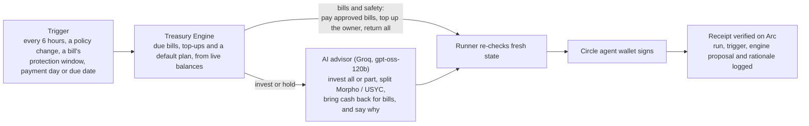

# Hodd

**An AI-run treasury for small businesses, settled in USDC on Arc.**

Hodd keeps a business's money ahead of what it owes. It does five things:

- tracks bills and their due dates;
- protects the cash those bills need;
- puts what is left to work in Morpho or Circle's USYC;
- pays bills from the owner's own wallet or vault;
- keeps a record of every decision.

**Autopilot** runs that loop from the owner's own vault contract. The owner's wallet owns it; Hodd's agent is only its operator. The agent may invest the whole balance. An AI advisor decides how much goes into Morpho and how much into USYC, when to move between them and when to bring money back to cash for upcoming bills, and writes down why. Each bill the owner approved is paid on its payment day whatever the advisor did. The only limit on the agent is where money can go, and the contract enforces that list.

Built from scratch for the **[Tameion Agents Hackathon](https://tameion.thecanteenapp.com/)** (Canteen × Circle, on Arc, Sep 27 – Oct 17, 2026). The first commit is the first day of the event.

| | |
| --- | --- |
| Live app (Arc Testnet) | [app.hoddfinance.xyz](https://app.hoddfinance.xyz) |
| Landing page | [hoddfinance.xyz](https://hoddfinance.xyz) |
| Network | Arc Testnet (chain ID `5042002`), USDC for value and gas |
| Contracts | [`contracts/`](./contracts) (Foundry). HoddieVaultFactory [`0x3115…e389`](https://testnet.arcscan.app/address/0x311578B21F269ca0E45f5c16324A3E51f69ce389) creates each user's vault; HoddUSYCVault [`0x97A7…0b76`](https://testnet.arcscan.app/address/0x97A7BAaA5416e0aC0674C395cec22FF606120b76) is allowlisted by Circle. Both verified on ArcScan |
| Contact | info@hoddfinance.xyz |

## Why Hodd

A small business's money is never one balance. Some is cash in a wallet earning nothing, some is owed on bills coming due, and some is a reserve that should earn while it waits. The decisions are small and constant, which is exactly the work an agent can do, as long as its authority ends somewhere it cannot talk its way past.

Hodd makes the protected amount the first number, not the last:

```text
protected capital  = bills due within 30 days + safety buffer + pending transactions
deployable capital = max(total treasury - protected capital, 0)
```

Only deployable capital can be invested. Bills are always funded first.

## What is in the app

Every page reads live balances from Arc Testnet, and every money movement ends with a receipt that the server verifies onchain.

| Page | What you can do there |
| --- | --- |
| **Overview** | See where the money sits: liquid cash, Morpho and USYC holdings with the protected line drawn through them, coverage and the next 30 days of bills. The **USDC on every chain** card shows the wallet's USDC on 12 Circle Gateway testnets as one balance. **Bring USDC to Arc** moves it to Arc with one button. |
| **Invest** | Deposit into, withdraw from or fully redeem an allowlisted **Morpho** vault through Circle's App Kit. Deposit USDC into **USYC** through Hodd's pooled vault and take USDC back, with no allowlisting needed for the user. |
| **Obligations** | Add bills with due dates and Arc recipients, and see them on a payment calendar and weekly outflow bars. Pay a bill from the connected wallet; it becomes **PAID** only after the USDC transfer is verified. A bill can also be paid **from another chain** through Gateway. |
| **Policy** | Set the safety buffer, the minimum liquidity coverage, the cap per strategy, the planning horizon (3 to 30 days) and how early bills are protected. Today's checks are shown as meters and the policy is stated in plain language. |
| **Autopilot** | **Invest N USDC** creates the owner's vault on first use and funds it. Approve a bill once with **Let Autopilot pay**, and the agent pays it from the vault on its payment day (a day before it is due). **Return everything** brings it all back through the agent; **Take everything back yourself** does it from the owner's wallet without Hodd. A progress rail follows each step to the verified receipt. **History** shows every run: what triggered it, what the engine proposed, what the AI advisor decided and why. |
| **Hoddie** | A treasury assistant in English and Turkish. It answers from the engine's own numbers ("Can I pay tomorrow's bills?") and drafts bills, policy changes and payment or Earn requests for the owner to approve. It never moves money. |
| **Activity** | A timeline of everything that happened. Local audit records are kept apart from onchain receipts. |
| **Connections** | Connect Hodd to Claude as a remote MCP connector with 19 tools. Reads are instant. Every write is previewed, approved by the user in Claude and recorded, and a connection can be revoked in one click. |

Actions that send money with one tap ask once: the first press turns the button into **Confirm?** and the second press sends.

**Wallets:** **MetaMask** and **Rabby** are verified end to end on the live host. **Circle Passkey** (Modular Wallets, gas sponsored by the Gas Station paymaster) and **Circle Embedded (PIN)** are built into the app; PIN stays switched off on the live host until it is verified there. Before any live operation the owner proves control of the wallet with a free signed message.

## How the agent decides



1. **When it runs.** A Supabase scheduler ticks every hour and starts a run when six hours have passed since the last one, the owner's policy changed, or a bill has entered its protection window, reached its payment day or fallen due. The owner can also start a run directly with Invest or Return everything.
2. **What comes first.** Hodd's Treasury Engine reads live balances, positions and bills in integer USDC minor units. It pays approved bills on their payment day (taking any missing part out of Morpho, then USYC) and tops up the owner's wallet for the bills the owner pays alone. It also proposes a plan for the rest, which is what happens when the advisor is unavailable.
3. **What the advisor chooses.** Where all of the vault's money sits. It can invest the whole balance, split it between Morpho and USYC in any proportion, keep money invested until a bill's payment day or bring it back to cash earlier, or move between the strategies. It must give a reason, and every answer is checked against what each strategy can take and pay out right now. It sees aggregate figures only, never addresses or bill names.
   - **Not its call:** paying a due bill, the owner's top-ups and returning everything never reach the model.
   - **Invalid answers:** an answer outside those bounds, an unparseable one or no answer at all leaves the engine's decision in place.
4. **Execution.** Before signing, the runner re-reads fresh state and refuses if anything moved. Then Circle's developer-controlled agent wallet signs, and the receipt is verified on Arc.
5. **The record.** Each run stores its inputs, the trigger, the engine's proposal, the advisor's action and rationale, the transactions and the verified receipts.

## Where the agent's authority stops

- **Where money can go, not how much.** The money sits in the owner's HoddieVault. The agent can send it to four places only: the allowlisted Morpho vault, Hodd's USYC pool, recipients the owner approved (never more per payment than the approved bill) and the owner's own wallet. The contract refuses anything else, and the owner can always run `withdrawAll`, even with Hodd offline.
- **The owner stays in charge.** The owner can pause the agent, ask for everything back, or set amount limits on the vault again with `setLimits`.
- **Bounds the model cannot widen.** The advisor can never pick another destination or skip a bill: on a bill's payment day the engine pays it first.
- **Bills first.** The engine never invests protected capital.
- **No guessing.** Amounts are integer USDC minor units computed by the engine. Stale balances mean no action. An uncertain outcome is never resubmitted automatically.
- **People confirm their own money.** Owner actions need the owner's wallet signature, and one-tap actions need a second press.
- **A complete record.** Every run, payment and Earn operation keeps its inputs, decision, transaction hash and server-verified receipt.
- **Kill switches.** One database row pauses all live execution within 30 seconds. Other rows pause just Earn, payments, Autopilot, the advisor, USYC or a single wallet provider.

The destinations are enforced onchain by [`HoddieVault`](./contracts/src/HoddieVault.sol): an allowlist of strategies, owner-approved recipients with a cap each, and slippage bounds on every strategy call. Hodd's server and database add a second layer: owner-only row-level security, single-use quotes, a per-wallet lease, and a payment ledger that never lets two payments of the same bill run at once.

## Circle and Arc stack

| Piece | Used for |
| --- | --- |
| **Arc Testnet + USDC** | Settlement in USDC, with USDC as gas |
| **Circle Wallets, user-controlled** | Circle Passkey (Modular Wallets) and Circle Embedded (PIN) for the owner's own wallet, alongside MetaMask and Rabby |
| **Circle agent wallet** | One Autopilot agent wallet per user, on Circle's developer-controlled Wallets through the App Kit Circle Wallets adapter. It is the vault's operator and signs every Autopilot step |
| **Gas Station paymaster** | Sponsored passkey transactions on Arc Testnet |
| **Circle App Kit (Earn)** | Vault discovery, Morpho deposits, withdrawals and redemptions |
| **Circle Gateway + Forwarding Service** | Unified USDC balance across 12 testnets. One button brings USDC to Arc: the shortfall is deposited with an EIP-2612 permit in a single `depositWithPermit` transaction, and a burn intent signed up front is submitted once Gateway credits it. Paying bills from another chain |
| **USYC** | Yield on reserve cash through [HoddUSYCVault](./contracts/src/HoddUSYCVault.sol). Circle allowlisted this one pooled contract, so users deposit and withdraw plain USDC and never need allowlisting themselves |
| **Contracts** | HoddieVaultFactory (one CREATE2 vault per owner and agent) and HoddUSYCVault, both deployed and verified on Arc Testnet |

## Verified live on Arc Testnet

| Flow | Evidence |
| --- | --- |
| **Autopilot, full cycle in production** (2026-10-11) | Invest: approval [`0x1dfe…8376`](https://testnet.arcscan.app/tx/0x1dfe79052419b228247398e55a40873343c0e0c7d1a60c0b20880e6678c78376), Morpho deposit of 8.955895 USDC [`0xb784…d953`](https://testnet.arcscan.app/tx/0xb78410ce3819829b843fdb5e14e396056acf99a726b254a04d7250664a58d953). Return everything: withdrawal [`0x81a6…bc96`](https://testnet.arcscan.app/tx/0x81a6ece8d993972592a50d754bc83cdd0ea8e612a7971427dd823811dd2dbc96), then 14.973529 USDC back to the owner [`0xd604…45b5`](https://testnet.arcscan.app/tx/0xd6048d1deadf6682feefb7176e471dc72071340c79ca8a20827354995dc045b5) |
| **Autopilot vault, full lifecycle** (2026-10-14) | The owner creates the vault, funds it and approves a recipient; the Circle agent deposits into Morpho, withdraws, pays the bill and sends cash to the owner; the contract refuses a payment over the cap and to an unknown address; the owner runs `withdrawAll`. Pay: [`0x6f25…6a01`](https://testnet.arcscan.app/tx/0x6f252005839251353d689cc8300f66ff73bbe1b51e52c14aeee238d104aa6a01) |
| **Autopilot vault with USYC, no amount limits** (2026-10-14) | Limits lifted with one `setLimits` ([`0x0b34…cb1e`](https://testnet.arcscan.app/tx/0x0b34d3cc443556bd42971d9a775c6342d2cd21a8d5711348f736b4b25698cb1e)). The Circle agent deposits 0.6 USDC into Hodd's USYC pool ([`0x0dfd…054d`](https://testnet.arcscan.app/tx/0x0dfd6795a8dc5b75370e01631f35d3b29b0109676f2dd10f31954247d456054d)), redeems 0.2 USDC back into the vault as for a bill ([`0x5baa…dea6`](https://testnet.arcscan.app/tx/0x5baadc5c4d405e7a6dbfb9fba7870fd577c5d07e6be816c9d6e7446b55cbdea6)) and the rest straight to the owner ([`0x5e98…7bb5`](https://testnet.arcscan.app/tx/0x5e987a7cdb946ec016b75aa27e7501260ba68d481df20b7508e17d2d933e7bb5)) |
| **Autopilot pays a real bill in production** (2026-10-14) | The owner approved the recipient once. Autopilot then paid the 2 USDC bill from the owner's vault, [`0x35ca…796b`](https://testnet.arcscan.app/tx/0x35ca2d3c7b45b55a32a1b9aec31c70f292259efc71edbe8763374a46c09d796b). The bill is PAID through the payment ledger |
| **AI advisor** | A live Groq call returned a decision inside the envelope with its reason. The hourly scheduler tick answered `200 READY` in production |
| **MetaMask and Rabby** | Wallet ownership proofs and verified bill payments with both; Morpho deposit, withdrawal and redeem-all with zero residual shares through Rabby |
| **Bill payment with a verified receipt** | 0.1 USDC, [`0xf5df…6de7`](https://testnet.arcscan.app/tx/0xf5df364fd1cb752ad08c2cfef31dea260c7a1d5acd7e65cc724315c5f30c6de7) |
| **USYC through HoddUSYCVault** | Deposit 1 USDC, then withdraw everything back to the same wallet |
| **Gateway, one button** | Shortfall deposited in one `depositWithPermit` transaction, the transfer signed before the deposit, minted on Arc |
| **Claude connector** | Dynamic registration, consent, all 19 tools, an approved write, a refused replay and revocation, on the production host |

Details: [Autopilot validation](./docs/autopilot-validation.md), [Gateway validation](./docs/gateway-validation.md), [USYC validation](./docs/usyc-validation.md), [Hoddie validation](./docs/hoddie-unified-validation.md).

## Usage so far

Snapshot from the production database on 2026-10-16. All values are testnet USDC.

| | |
| --- | --- |
| Accounts | 6: our own test business and 5 people from our circle |
| Arc transactions sent through Hodd, each with a server-verified receipt | 81: 20 signed by the Circle agent wallet, 51 Morpho Earn steps (including approvals) and 10 bill payments from owner wallets. 37 of them were signed by users' own wallets (MetaMask, Rabby) or the agent; the rest by the development test signer used for regression runs. Gateway, USYC and vault-setup transactions come on top |
| Autopilot runs | 28: 11 completed, 13 with nothing to do, 1 partial, 3 stopped safely |
| USDC moved by the agent in verified steps | 143.81 |
| Completed Morpho operations | 24: 12 deposits, 7 withdrawals, 5 redeem-all |
| Bills paid with a verified receipt | 13 (3 of them paid by Autopilot from the owner's vault) |
| Changes approved through Claude or Hoddie | 9 (6 Claude, 3 Hoddie) |

## Try it

1. Open [app.hoddfinance.xyz](https://app.hoddfinance.xyz) and sign up with your email.
2. Connect a wallet (MetaMask or Rabby is the quickest) and sign the free ownership message.
3. Get free testnet USDC from the [Circle faucet](https://faucet.circle.com): Arc Testnet, and optionally another chain such as Base Sepolia.
4. On **Obligations**, add a bill. Watch protected and deployable capital change on **Overview**.
5. On **Invest**, deposit into Morpho or the USYC pool: press once, then **Confirm?**.
6. If you have USDC on another testnet, use **Bring USDC to Arc** on Overview.
7. On **Autopilot**, press **Invest 5 USDC**, then **Confirm?**. The first time, your wallet also creates your vault. Press **Let Autopilot pay** for a bill. Open **History** to see each decision and the advisor's reason. **Return everything** brings it all back.
8. Ask **Hoddie** "Can I pay tomorrow's bills?", then check **Activity** for the record.

Each deposit or payment on the live host is capped at 1,000 testnet USDC. Gateway moves need MetaMask or Rabby.

## Built during Tameion

| When | What was added |
| --- | --- |
| Sep 27 – Oct 2 | Treasury Engine and console, Circle wallets (Passkey, Embedded, MetaMask, Rabby), guarded Morpho Earn, payment ledger |
| Oct 6 – 9 | Live testnet host with kill switches, wallet ownership proofs, durable Earn and payment state machines, Claude connector (MCP), Hoddie assistant, landing page |
| Oct 10 – 11 | Autopilot agent wallet (one-click Invest and Return everything), Circle Gateway (unified balance, bring to Arc, pay from another chain), MetaMask verified live |
| Oct 12 – 13 | HoddieVault and factory, HoddUSYCVault deployed and allowlisted by Circle, USYC in the app, AI advisor with six-hourly and event triggers, one-button Gateway with permit deposits, a visual redesign of every page |
| Oct 14 | HoddieVaultFactory deployed; Autopilot runs from each owner's vault and pays approved bills through the payment ledger |
| Oct 15 – 16 | Landing page with the Claude connector, proof, use cases and FAQ; terms, risk and privacy pages; CI on GitHub Actions; hardened database write handling |

## Architecture and tests

- **Next.js 16** (App Router) on Vercel. One project serves the landing page on `hoddfinance.xyz` and the console on `app.hoddfinance.xyz`.
- **Supabase** handles authentication and owner-scoped workspaces, and stores quotes, executions, receipts, leases and agent runs behind owner-only row-level security. It also runs the scheduler (pg_cron) and keeps secrets in Vault.
- **Treasury Engine** (`src/lib/treasury`): pure, deterministic functions over integer minor units.
- **Execution** is a durable, request-driven state machine. The server records the exact next call, the wallet signs, the server verifies the receipt and moves on. It works on serverless hosts and survives restarts.
- **Contracts** (`contracts/`): Solidity 0.8 with Foundry and OpenZeppelin 5.
- **Tests:** 884 Vitest unit and component tests, 104 Playwright browser checks on desktop and mobile, 245 Foundry tests (unit, fuzz, invariant, Arc fork). GitHub Actions runs lint, typecheck and unit tests on every push. Opt-in live tests run against Arc Testnet.

## Roadmap

- Verify Circle Passkey and Circle PIN on the live host and switch them on.
- Onboard outside businesses.
- An independent security audit of the contracts and preparation for mainnet.

Contracts are testnet-grade and unaudited. Everything runs on testnet.

---

# Developer guide

## Setup

```bash
pnpm install
pnpm dev
```

Copy `.env.example` to git-ignored `.env.local`:

| Variable | Purpose |
| --- | --- |
| `NEXT_PUBLIC_SUPABASE_URL`, `NEXT_PUBLIC_SUPABASE_PUBLISHABLE_KEY` | Supabase project |
| `SUPABASE_SECRET_KEY` | Server only; writes verified payment and evidence records |
| `CIRCLE_API_KEY`, `CIRCLE_ENTITY_SECRET` | Circle user wallets and the Autopilot agent wallet (server only) |
| `NEXT_PUBLIC_CIRCLE_APP_ID`, `NEXT_PUBLIC_CLIENT_KEY` | Circle User-Controlled Wallets and Modular Wallets (client key restricted to your domain) |
| `GROQ_API_KEY` | Autopilot advisor (falls back to Supabase Vault) |
| `GEMINI_API_KEY`, `OPENROUTER_API_KEY` | Hoddie's command interpretation |
| `HODD_EARN_EXECUTION_ENABLED`, `HODD_PAYMENT_EXECUTION_ENABLED`, `HODD_AGENT_EXECUTION_ENABLED` | Enable execution locally (`next dev` on loopback) |

Apply every migration in `supabase/migrations`. User wallets need no private key, seed phrase or entity secret; users connect through the browser, a PIN or a passkey.

## Live testnet mode

Live mode opens only when all of these hold: a Vercel production deployment, the request host exactly `app.hoddfinance.xyz`, `HODD_TESTNET_LIVE=true` and the database's main switch on. Preview URLs stay closed.

- **Kill switch:** `update public.hodd_live_controls set enabled = false where key = 'EXECUTION';` pauses all live execution within 30 seconds. `EARN`, `PAYMENTS`, `AGENT`, `AGENT_ADVISOR`, `USYC` and `PROVIDER:<name>` pause one area.
- **Limits:** per-user quote and execution rate limits per minute and per day; each deposit or payment is capped at 1,000 testnet USDC; withdrawals are never capped; one open execution per user and per wallet.
- **Uncertainty:** an uncertain outcome is never retried automatically. The user resolves it with **Check again** or **Verify this transaction** (paste a hash).

## Sites and domains

| Host | Serves |
| --- | --- |
| `hoddfinance.xyz`, `www.hoddfinance.xyz` | Landing page and legal pages (`/terms`, `/risk`, `/privacy`) |
| `app.hoddfinance.xyz` | Treasury console, sign-in and API routes (not indexed) |
| Any other host (previews, localhost) | The console; the landing page is at `/landing` |

Routing lives in `src/proxy.ts`, host lists in `src/lib/site/hosts.ts`.

## Further reading

| Topic | Document |
| --- | --- |
| Autopilot, vault mode, advisor and scheduler | [docs/autopilot-validation.md](./docs/autopilot-validation.md) |
| Circle Gateway | [docs/gateway-validation.md](./docs/gateway-validation.md) |
| USYC and HoddUSYCVault | [docs/usyc-validation.md](./docs/usyc-validation.md), [contracts/README.md](./contracts/README.md) |
| Hoddie | [docs/hoddie-unified-validation.md](./docs/hoddie-unified-validation.md) |

## Verification

```bash
pnpm typecheck
pnpm lint
pnpm test
pnpm build
pnpm test:e2e
cd contracts && forge test
```

## License

MIT — see [LICENSE](./LICENSE).
